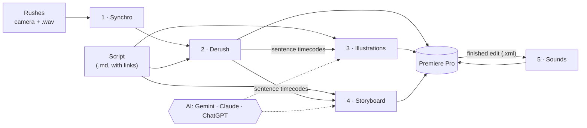

<h1 align="center">FauxRaccord</h1>

From a long talking-head recording and its script to an edit with illustrations, in Premiere Pro. 
Free, open source, runs on your PC. Windows. Interface in French and English; videos in French or English.

---

FauxRaccord does the slow parts of a YouTube video essay for you:

1. **Synchro**: lines up the camera files and the external audio by their sound, like PluralEyes.
2. **Derush**: keeps the best take of every line of your script and removes the silences, false starts and stumbles. You get a Premiere sequence, with every sentence marked.
3. **Illustrations**: finds pictures and videos for every paragraph — from the links in your script, archives and museums (Wikimedia, Europeana, the Met, David Rumsey maps), the web and YouTube — then an AI looks at them and drops the off-topic ones. You tick what you want on a contact sheet, and the files land in your sequence, on the sentence they illustrate, with the credits written for you — or you drag a thumbnail straight onto the Premiere timeline. Each picture shows its date, and the AI is told which period each paragraph is about, so photos of earlier, similar events get flagged.
4. **Storyboard**: describe a style (« 3D lowpoly like Fern and Lemmino, plus clean motion design for maps and numbers ») and get a shot-by-shot plan of what to create: what we see, camera moves, image and video prompts, a scene to build in Blender. Each shot appears as a card at its place in your timeline.
5. **Sounds**: whooshes, clicks, pops and typing on everything that moves on screen in your finished edit — clips appearing, transitions, zooms, and the animations inside your rendered motion design. Takes vary, levels are set, and you hear and adjust every sound on a page with the waveforms before they go into Premiere on their own tracks. Sounds come from your own folders (your Epidemic, Artlist or Envato downloads), your Epidemic Sound subscription, or a free built-in bank. It learns your habits from the sounds already in your edit. Or by hand: the **sound board** holds your sound effects, ambiences and music in three tabs — drag a « Whoosh » tile onto the timeline and get a different take every time.

Each step also works on its own.

| | |
|---|---|
|  |  |
| The window: one page per step | Picking illustrations: rights, source and the AI's verdict on each |
|  |  |
| Describe a style… | …get the shots, editable, with prompts |

## What you need

- Windows 10 or 11.
- Adobe Premiere Pro (any recent version opens the XML files; the panel that places files in the open sequence needs 2025, v25.6 or later).
- About 6 GB of disk space (the speech recognition model is 3 GB).
- An NVIDIA graphics card is recommended: transcription works without one, but much more slowly.
- For Illustrations and Storyboard, one AI (see below). Synchro and Derush need none.

## Install

1. **Download `FauxRaccord-Setup.exe`** from the [latest release](https://github.com/lihogloglo/FauxRaccord/releases/latest) and run it. No admin rights needed. It installs Python and FauxRaccord's libraries (about 2 GB, a few minutes), adds FauxRaccord to the Start menu and the desktop, and opens it.
   Windows may show « Windows protected your PC » (the installer is not signed): **More info › Run anyway**.
2. In the window, open **Installation** (bottom left) and install what is missing — ffmpeg, the speech model. One click each. The Premiere panel is already there: restart Premiere, then *Window › UXP Plugins › FauxRaccord*. It starts FauxRaccord by itself when it is not running.
3. Open **IA** and connect an AI.

To update: **Installation › FauxRaccord › Update** (it closes, updates and reopens). To uninstall: Windows Settings › Apps › FauxRaccord (your settings, keys and the downloaded speech model are kept).

From the source instead (to work on the code): `git clone` this repository and double-click `FauxRaccord.bat` (installs uv and the packages, puts a shortcut on the desktop); update with `git pull` and `FauxRaccord.bat` again.

## Connecting an AI

Use what you already have. On the **IA** page:

| You have | What to do | Cost |
|---|---|---|
| A Google account | Get a free key at [aistudio.google.com/apikey](https://aistudio.google.com/apikey) and paste it | free tier, or ~2 $ per episode on a paid key |
| A Gemini subscription (Google AI Pro/Ultra) | **Installer**, then **Connecter** (Antigravity) | included |
| ChatGPT Plus/Pro | **Installer**, then **Connecter** (Codex) | included |
| Claude Pro/Max | **Installer**, then **Connecter** (Claude Code) | included |

FauxRaccord uses your subscription through the official app of each company, signed in with your own account. **Tester** checks that it works. Subscriptions are slower, and count against your plan's usage limits.

## Using it

Everything starts from your **script**: a text or Markdown file, one `##` heading per section, with the links to your sources in it. Its folder is the **project** (top left): every step writes there, and opening a folder picks up whatever is already in it, so you can start at any step. Drop files anywhere on the window.

- **Synchro**: drop the rushes (or their folder), click **Synchroniser**, import the `.sync.xml` in Premiere.
- **Derush**: drop the sequence (the Synchro result, or any sequence exported from Premiere with *File › Export › Final Cut Pro XML*) and the script, click **Derusher**. It also continues a half-done derush without touching your cuts.
- **Illustrations**, **Storyboard** and **Sons** share one layout, and each works on its own: **Entrées** (the script and the edit, as drop zones; the edit is the same for every step), **Consignes pour l'IA** (what you want, in your words, and the button that starts the AI), and **Résultat**: the **planche** — the board where you look, listen and drag straight into the Premiere timeline — and, beside it, **Automatique**, which places everything for you.
- **Illustrations**: **Collecter**, then **Ouvrir la planche**: drag a thumbnail into Premiere where you want it (hover to enlarge, ⬇ to download), or mark it **✓ Choisie**. **Placer dans Premiere** puts the chosen pictures — and, unless you switch it off, the AI's best picture for the other sentences — each at its sentence, through the Premiere panel (*Window › UXP Plugins › FauxRaccord*); **→ Premiere** on a card puts just that one at the playhead; **ou exporter le XML** writes the same thing as a file to import.
- **Storyboard**: write the style, **Créer les plans**. On the planche, edit or redo any shot, mark the ones to keep (**✓ Gardé**: not redone when you run again), drag a card into Premiere; or **Placer dans Premiere** puts every card at its place.
- **Sons**: drop the finished edit (*File › Export › Final Cut Pro XML*), add your sound folders or your Epidemic key. The **planche sonore** holds your sound effects (tiles: drag « Whoosh » and get a different take each time), ambiences and music; **Proposer ambiances et musiques** fills its *Pour le script* view from your instructions, never placed without you. **Analyser le montage** puts sounds on everything that moves: listen and adjust them in the board's **Sur le montage** tab (Space plays the voice with the sounds, ←/→ jumps from sound to sound, A/Z changes the take), then **Exporter pour Premiere (.xml)**.

Re-run any step after re-editing: FauxRaccord finds every sentence again wherever it ended up in your edit.

## Privacy

Your rushes and audio never leave your PC: transcription and syncing run locally. For Illustrations and Storyboard, the script's text and small thumbnails are sent to the AI you chose, and search queries to the archives and websites searched.

## More

- [Technical details](docs/details.md): how each step decides, command-line use, all options and file formats.
- Run the tests: `uv run --with pytest pytest`.

## License

[MIT](LICENSE). Illustrations found by FauxRaccord keep their own licences: check them before publishing (the contact sheet shows each one's rights and source, and the export writes the credits).
