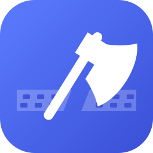
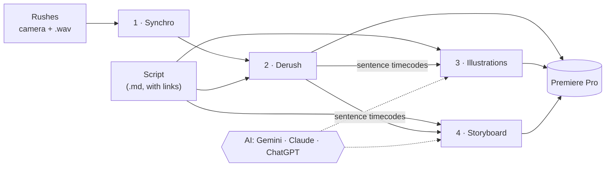
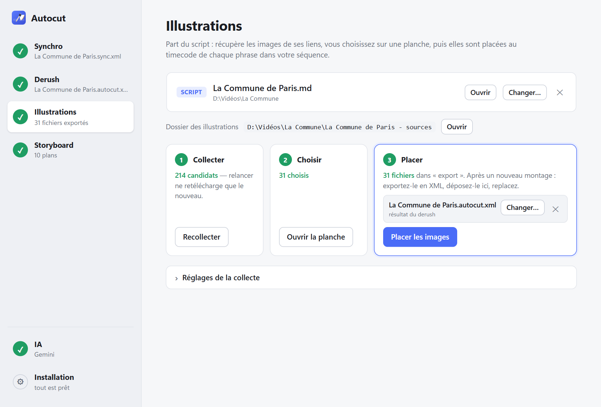
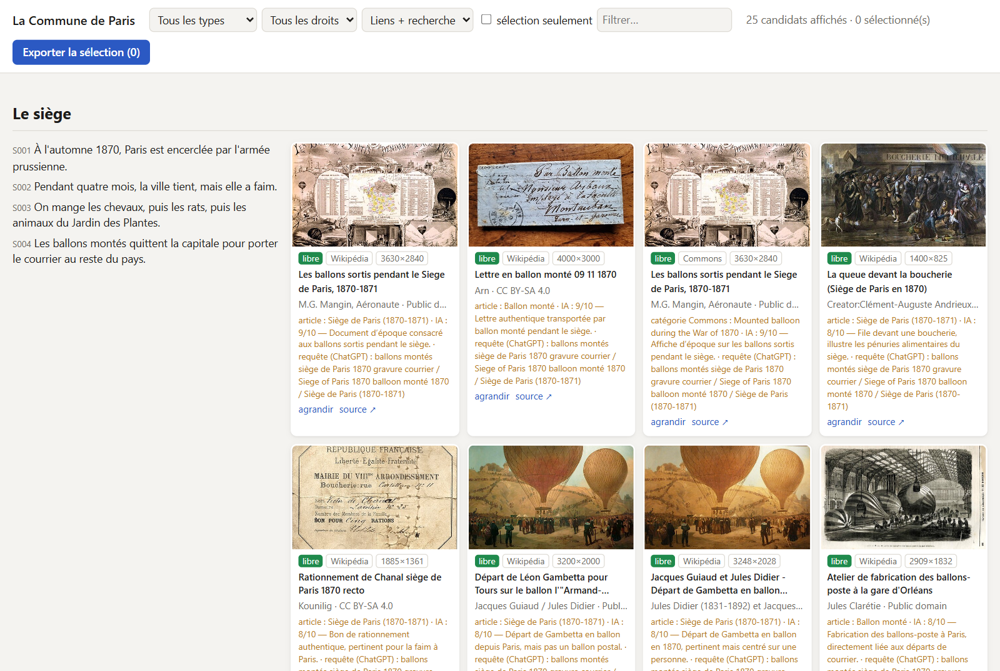
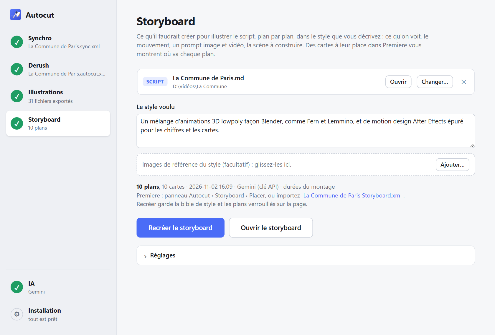
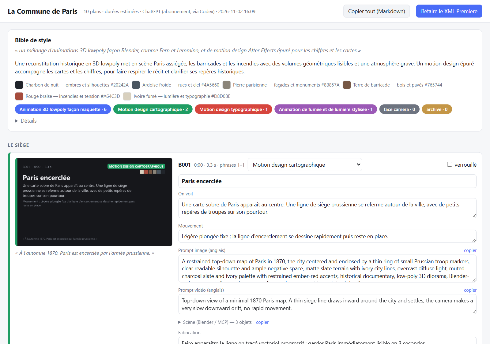

<h1 align="center">Autocut</h1>

From a long talking-head recording and its script to an edit with illustrations, in Premiere Pro. 
Free, open source, runs on your PC. Windows. Interface in French and English; videos in French or English.

---

Autocut does the slow parts of a YouTube video essay for you:

1. **Synchro**: lines up the camera files and the external audio by their sound, like PluralEyes.
2. **Derush**: keeps the best take of every line of your script and removes the silences, false starts and stumbles. You get a Premiere sequence, with every sentence marked.
3. **Illustrations**: finds pictures and videos for every paragraph — from the links in your script, archives and museums (Wikimedia, Europeana, the Met, David Rumsey maps), the web and YouTube — then an AI looks at them and drops the off-topic ones. You tick what you want on a contact sheet, and the files land in your sequence, on the sentence they illustrate, with the credits written for you — or you drag a thumbnail straight onto the Premiere timeline. Each picture shows its date, and the AI is told which period each paragraph is about, so photos of earlier, similar events get flagged.
4. **Storyboard**: describe a style (« 3D lowpoly like Fern and Lemmino, plus clean motion design for maps and numbers ») and get a shot-by-shot plan of what to create: what we see, camera moves, image and video prompts, a scene to build in Blender. Each shot appears as a card at its place in your timeline.

Each step also works on its own.

| | |
|---|---|
|  |  |
| The window: one page per step | Picking illustrations: rights, source and the AI's verdict on each |
|  |  |
| Describe a style… | …get the shots, editable, with prompts |

## What you need

- Windows 10 or 11.
- Adobe Premiere Pro (any recent version opens the XML files; the panel that places files in the open sequence needs 2025, v25.6 or later).
- About 6 GB of disk space (the speech recognition model is 3 GB).
- An NVIDIA graphics card is recommended: transcription works without one, but much more slowly.
- For Illustrations and Storyboard, one AI (see below). Synchro and Derush need none.

## Install

1. **Download Autocut**: on this page, green **Code** button › **Download ZIP**, then unzip it where you keep your tools (or `git clone` it).
2. **Double-click `Autocut.bat`**. The first time it installs what it needs (a few minutes), puts an **Autocut** shortcut on your desktop and opens the window. Afterwards, use the shortcut.
3. In the window, open **Installation** (bottom left) and install what is missing — ffmpeg, the speech model, the Premiere panel. One click each.
4. Open **IA** and connect an AI.

To update: download the new version over the old one (or `git pull`) and double-click `Autocut.bat` again.

## Connecting an AI

Use what you already have. On the **IA** page:

| You have | What to do | Cost |
|---|---|---|
| A Google account | Get a free key at [aistudio.google.com/apikey](https://aistudio.google.com/apikey) and paste it | free tier, or ~2 $ per episode on a paid key |
| A Gemini subscription (Google AI Pro/Ultra) | **Installer**, then **Connecter** (Antigravity) | included |
| ChatGPT Plus/Pro | **Installer**, then **Connecter** (Codex) | included |
| Claude Pro/Max | **Installer**, then **Connecter** (Claude Code) | included |

Autocut uses your subscription through the official app of each company, signed in with your own account. **Tester** checks that it works. Subscriptions are slower, and count against your plan's usage limits.

## Using it

Everything starts from your **script**: a text or Markdown file, one `##` heading per section, with the links to your sources in it. Its folder is the **project** (top left): every step writes there, and opening a folder picks up whatever is already in it, so you can start at any step. Drop files anywhere on the window.

- **Synchro**: drop the rushes (or their folder), click **Synchroniser**, import the `.sync.xml` in Premiere.
- **Derush**: drop the sequence (the Synchro result, or any sequence exported from Premiere with *File › Export › Final Cut Pro XML*) and the script, click **Derusher**. It also continues a half-done derush without touching your cuts.
- **Illustrations**: **Collecter**, tick pictures on the contact sheet that opens in its own window (hover a thumbnail to enlarge it, ⬇ to download one, drag it into Premiere to place it by hand), **Télécharger la sélection**, then **Placer** writes the XML with each picture at its sentence — or, in Premiere, *Window › UXP plugins › Autocut* › **Placer les illustrations**.
- **Storyboard**: write the style, **Créer le storyboard**. Edit or redo any shot on the page that opens; place the cards with the Premiere panel (**Quoi › Storyboard**) or import the `.xml`.

Re-run any step after re-editing: Autocut finds every sentence again wherever it ended up in your edit.

## Privacy

Your rushes and audio never leave your PC: transcription and syncing run locally. For Illustrations and Storyboard, the script's text and small thumbnails are sent to the AI you chose, and search queries to the archives and websites searched.

## More

- [Technical details](docs/details.md): how each step decides, command-line use, all options and file formats.
- Run the tests: `uv run --with pytest pytest`.

## License

[MIT](LICENSE). Illustrations found by Autocut keep their own licences: check them before publishing (the contact sheet shows each one's rights and source, and the export writes the credits).
